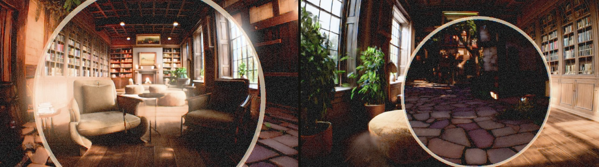

# Splat Lab

Browser experiments with Gaussian splatting and photoreal three.js. Relighting splats, path tracing photoscans, AI-generated worlds, real scans as levels, and a bodycam game that runs on top of all of them.



## Run it

Everything is static: HTML pages that load three.js, [Spark](https://sparkjs.dev) and the worlds from CDNs. Serve the folder and open the gallery:

```bash
python3 -m http.server 8771
```

Then open http://localhost:8771/. A recent Chrome on a desktop GPU is best. The WebGPU path tracer needs WebGPU.

## Demos

| Demo | What it shows | Page |
|---|---|---|
| **Last Light: AI worlds** | Bodycam patrol in a Marble-generated splat world, with capsule collision against the generated collider | [`demos/ai-worlds/`](demos/ai-worlds/) |
| Lights out | Per-splat relighting of baked worlds: night, a torch with a beam cone, facing and shadows | `demos/ai-worlds/?night=1` |
| Shoot the walls | Splat debris: rigid chunks, dust and craters, computed from the time since each shot | `demos/ai-worlds/` (click to fire) |
| Portal hop | One splat world seen and entered through a ring in another, two passes with disk clipping | `demos/ai-worlds/?portal=library` |
| Scans as levels | Collision built from a scan's own splats, auto-levelling, start-point search | `demos/ai-worlds/?splat=<url>` |
| **Last Light: photoscans** | The same game on PBR photoscans with an HDR sky, a real-time dusk and torch shadows | [`demos/bodycam-scans/`](demos/bodycam-scans/) |
| **Splat Relight Lab** | A captured splat room plus a relightable PBR mesh, matched by an environment captured from the splats | [`demos/relight-lab/`](demos/relight-lab/) |
| **Path traced** | Photoscanned Namaqualand under a sky photo, path traced in WebGL | [`demos/path-traced/`](demos/path-traced/) |
| **Path traced, WebGPU** | The same scene with WebGPU compute and the Open Image Denoise denoiser | [`demos/path-traced-webgpu/`](demos/path-traced-webgpu/) |

The gallery (`index.html`) links each one, including the variants below.

### Game controls (both versions)

Mouse to look (click to capture), **WASD** to walk, Shift to run, **E** to cut a snare, **Q** for the tracker, **F** for the torch.

The AI-world version adds:
- **N** for night
- Click or Space to fire
- **V** to show the collision mesh
- **H** to hide the on-screen display
- **C** for a clean camera without the bodycam filters

### URL options for `demos/ai-worlds/`

| Option | Effect |
|---|---|
| `splat=<url>` with `collider=<url>` | Load any Marble export (`.spz` and its `_collider.glb`) |
| `splat=<url>` alone | Load a scan: collision is built from the splats. Takes `.spz`, `.ply` (including SuperSplat-compressed), `.splat`, `.sog` |
| `name=` | Label on the start card |
| `scale=` | World scale for scans that aren't in metres |
| `up=z` | For z-up files (set automatically for InteriorGS) |
| `voxel=` | Collision voxel size, default 0.1 m |
| `portal=library\|lane\|house\|kitchen\|apartment\|0` | What the portal opens onto (default `library`), or no portal |
| `night=1` | Start at night with the torch on |
| `clean=1`, `ui=0` | Start with the clean camera, or with the display hidden |
| `msaa=`, `rs=`, `splats=`, `lod=1` | Performance testing: multisampling, render scale, splat budget, Spark level of detail |

You can also drag files onto the start card: a Marble world's `.spz` and `.glb` together, or a scan on its own. Its `occupancy.json` and `.png` can be dropped too.

## Techniques, and where they live

All the splat work is in [`src/game/ai_main.js`](src/game/ai_main.js). [`src/game/build.py`](src/game/build.py) assembles it with the shared game parts into `demos/ai-worlds/index.html`.

- **Loading generated worlds** (`loadWorld`):
  - Raw Marble exports are stored upside down (y-down). The page detects that from the spread of splat heights.
  - The collider is turned whichever way sits closer to the splats.
  - The world is scaled so the camera it was generated from stands at eye height.
- **Frame budget** (`pruneSplats`, footage pipeline):
  - Drawing cost is per splat, about 4 ms per million on an M-series Mac, so worlds over budget keep their most visible 2.5M splats.
  - Multisampling is off: it quadrupled the cost and splats don't need it.
  - The exposure meter reads back asynchronously.
- **Relighting** (`LIGHT_GLSL`, `makeLightModifier`): a Spark `dyno` world modifier runs on every splat each frame the torch moves.
  - The baked colour is dimmed and partly flattened.
  - A torch adds a cone, inverse-square falloff and facing taken from the splat's thinnest axis.
  - Shadows come from the collision mesh drawn into a distance map from the torch.
- **Debris** (`DEBRIS_GLSL`, `fire`, `splatHit`):
  - Up to 32 impacts are kept in uniform arrays.
  - Splats near a hit are hashed into 7.5 cm cells that fly as rigid chunks; their arcs, tumbling and landing are worked out from the time since the shot.
  - Hits come from a hash grid of opaque splat centres, under 3 ms per shot instead of Spark's 50 ms brute-force raycast.
- **Portals** (`renderWorld`, `openPortal`, `hop`):
  - There is one Spark renderer with its disk-portal shader, plus a second used only to sort the far world.
  - Each world is drawn only in its own pass.
  - Walking through moves collision, shadows, hit testing and the torch to the other world.
- **Scans as levels** (`splatCollider`, `levelScan`, `occupancySpawn`):
  - Opaque splats are binned into voxels and floor holes are patched; the exposed faces become a collision mesh.
  - Tilted scans are levelled with RANSAC.
  - The start point is the roomiest indoor floor. For InteriorGS it comes from the occupancy map (mirrored on x, sealed at doorways).

[`docs/findings.md`](docs/findings.md) has the numbers, dead ends and gotchas from building all this.

## Layout

```
index.html              gallery
demos/                  one folder per page (the two game pages are built, don't edit them directly)
src/game/               game sources and build scripts: python3 src/game/build.py
assets/panoramas/       4K equirectangular inputs prepared for Marble (from Poly Haven HDRIs, CC0)
docs/                   findings and screenshots
scenes/                 local scene files, not committed (see scenes/README.md)
```

## Credits and licences

Code: MIT ([LICENSE](LICENSE)). Worlds, scans, models and textures are not part of the code licence. They stream from their authors' hosts and keep their own licences, listed in [CREDITS.md](CREDITS.md). Scenes with non-redistributable terms (InteriorGS) are never committed.
